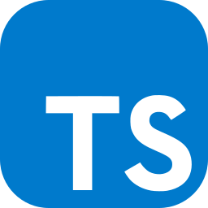
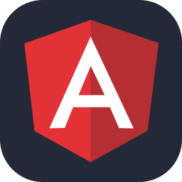
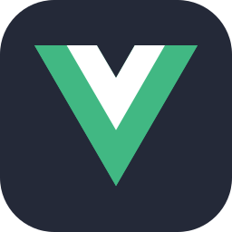
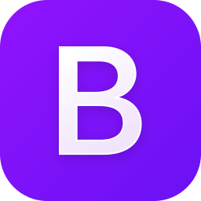
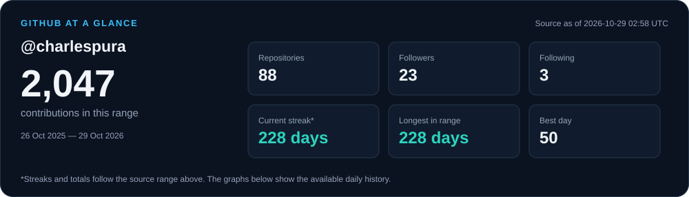
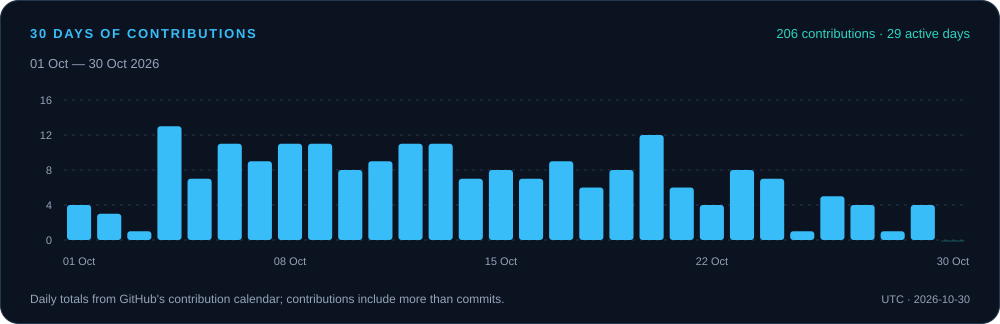
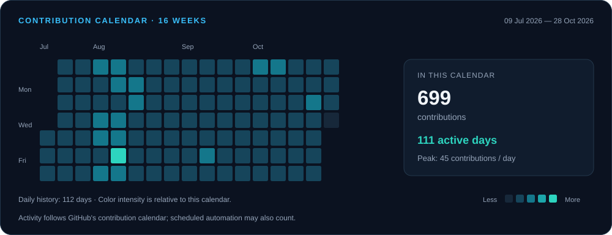

# Hi, I'm Charles Pura

**I build web applications that make everyday tasks easier.**

[About](#about-me) · [Projects](#selected-projects) · [Tech stack](#technologies-i-work-with) · [GitHub activity](#github-activity) · [Connect](#lets-connect)

## About me

I'm a **full-stack developer from Quezon City, Philippines**, and a **BSIT graduate, Cum Laude**, majoring in Information Management at Bestlink College of the Philippines.

My projects span adoption management, reporting automation, personal finance, and productivity. I like connecting a clear interface with the logic and data behind it, and learning by building complete applications.

- **Web development:** responsive interfaces, application workflows, APIs, and databases.
- **Exploring:** mobile app development and ways to make applications more useful and intuitive.
- **Open to:** project collaboration, mentorship, and conversations with other developers.

## Selected projects

A few projects that show how I approach different problems, from managing records to building better daily habits.

<table>
  <tr>
    <td width="50%" valign="top">
      <h3>01 · Dog Adoption Management</h3>
      
A full-stack application for browsing adoptable dogs and managing adoption requests, with user authentication and an admin dashboard.

      
<code>Angular</code> <code>Node.js</code> <code>GraphQL</code> <code>MySQL</code>

      
<a href="https://github.com/charlespura/chDogAdoptionManagementSystem"><strong>Explore the code →</strong></a>

    </td>
    <td width="50%" valign="top">
      <h3>02 · Auto Reporting System</h3>
      
A reporting application with scheduled report generation, Excel and PDF exports, email delivery, and support for multiple database connections.

      
<code>Laravel</code> <code>Vue.js</code> <code>Bulma</code> <code>Docker</code>

      
<a href="https://github.com/charlespura/AutoReportingSystem"><strong>Explore the code →</strong></a>

    </td>
  </tr>
  <tr>
    <td width="50%" valign="top">
      <h3>03 · FocusForge</h3>
      
A Pomodoro productivity app that brings focus sessions, task management, and progress analytics together, with offline support as an installable PWA.

      
<code>React</code> <code>TypeScript</code> <code>Tailwind CSS</code> <code>Zustand</code>

      
<a href="https://charlespura.github.io/FocusForge/"><strong>Try it live →</strong></a> · <a href="https://github.com/charlespura/FocusForge">Source code</a>

    </td>
    <td width="50%" valign="top">
      <h3>04 · chIPON Challenge</h3>
      
A gamified savings tracker with daily spins, automatic savings goals, and progress logs. Challenge data stays in the browser with local storage.

      
<code>React</code> <code>Vite</code> <code>Tailwind CSS</code> <code>JavaScript</code>

      
<a href="https://github.com/charlespura/chIPON-CHALLENGE"><strong>Explore the code →</strong></a>

    </td>
  </tr>
</table>

**More to explore:** [QR Navigation System](https://github.com/charlespura/Blpc-Qr-Navigation-System) · [GitHub Stats Generator](https://github.com/charlespura/gtihubstats) · [All repositories](https://github.com/charlespura?tab=repositories)

## Technologies I work with

### Frontend

  
  
  
  
  
  
  

JavaScript · TypeScript · React · Angular · Vue.js · HTML · CSS

### Styling

  
  
  

Tailwind CSS · Bootstrap · Bulma

### Backend & APIs

  
  
  
  
  

PHP · Laravel · Node.js · Express · GraphQL · REST APIs · JWT authentication

### Data

  
  
  
  

MySQL · MongoDB · Firebase · Supabase

### Tools & deployment

  
  
  
  
  
  
  
  
  

Git · GitHub Actions · Docker · Postman · Figma · Vite · Render · Vercel · GitHub Pages

  
<strong>More technologies I've explored</strong>

Java, Python, React Native, Expo, Android Studio, Three.js, and jQuery.

## GitHub activity

Contributions, coding streaks, and recent activity at a glance.

  

  

### Contribution snake

  

  
<strong>Explore my contribution calendar</strong>

  

[Live stats dashboard](https://charlespura.github.io/gtihubstats/) · [GitHub contribution history](https://github.com/charlespura?tab=overview) · [How I generate the data](https://github.com/charlespura/gtihubstats)

Charts show the source dataset's update time. Contribution activity includes automated workflow commits.

## Let's connect

Have a project in mind, an idea to explore, or feedback on my work? I'd love to hear from you.

**[Visit my portfolio](https://charlespura.onrender.com/)** · **[Connect on LinkedIn](https://www.linkedin.com/in/charlespura)** · **[Send me an email](mailto:charles051902pura@gmail.com)**

[Facebook](https://web.facebook.com/charlespuracp) · [ORCID](https://orcid.org/0009-0004-3419-8788)
